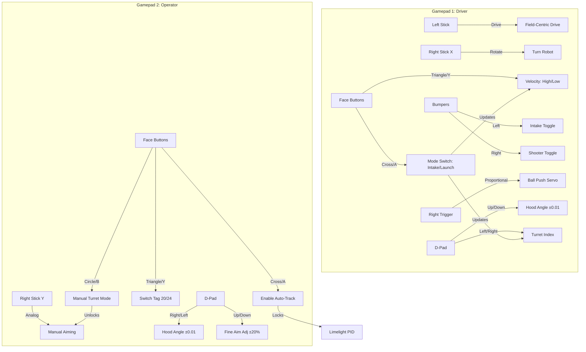
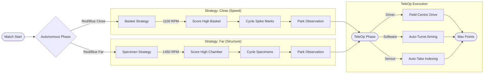

# 🎯 DECODE 14464: Strategic Implementation & Game Strategy

## Core Philosophy: Software-Defined Velocity
Our strategy is to maximize match points by executing the highest number of scoring cycles possible. We achieve this not just through mechanical speed, but by **eliminating wasted software time**. By automating precision tasks (aiming, indexing), we convert driver reaction time into scoring time.

---

## 🎮 Controller Layout Visualization

---

## 🏎️ Robot Design & Scoring Priorities

### 1. Optimize for "Effective" Speed
Raw motor speed is useless without control. Our software optimizes **Effective Speed**:
*   **Shoot-While-Driving:** The **Auto-Turret** system (PID+F control) allows the driver to score without stopping to align. Unlike teams that must square up against a wall, our robot maintains forward momentum while the software handles the trajectory.
*   **Field-Centric Agility:** We utilize **Pedro Pathing** in autonomous and field-centric drive in TeleOp, decoupled from the turret's rotation. This allows complex maneuvers (dodging defense) without losing lock on the goal.

### 2. High-Volume Scoring Cycles
Early in the season, volume beats complexity. Our software enables rapid throughput:
*   **Smart Indexing:** The intake's color sensor and auto-advance logic allow the driver to "mow" over game elements rather than stop-and-pick. The robot automatically manages its own internal inventory (up to 3 slots).
*   **Context-Aware Modes:** Transitioning from "Intake" to "Launch" is a single button press that reconfigures servos, motors, and vision pipelines instantly, minimizing maneuver time between the source and the goal.

### 3. Vision-Assisted Consistency
We prioritize reliability over theoretical ceilings.
*   **Global-Shutter Precision:** Using the **Limelight 3A**, we implement a heavy low-pass filter (73%) to ignore lighting flickers and motion blur, ensuring our targeting data is "blur-free" and actionable in real-time.
*   **Pinpoint Odometry:** We implemented the **GoBilda Pinpoint IMU** to feed precise heading data into our drive loops, ensuring that even if the robot is hit, it knows exactly where "forward" is and corrects instantly.

---

## 🎮 In-Match Scoring Strategy

### 🤖 Autonomous: Reliability by Design
We refuse to run a "hope and pray" autonomous. Our strategy relies on **location-aware logic**:
*   **Close Position (Basket Strategy):** We run `Auto_Blue_Close` / `Auto_Red_Close` which optimizes for short travel distances. We lower flywheel velocity (1100 RPM) to increase accuracy and minimize bounce-outs, prioritizing spike mark clearing.
*   **Far Position (Specimen Strategy):** We run `Auto_Blue_Far` / `Auto_Red_Far` which focuses on structure. We increase velocity (1450 RPM) and handle the complex pathing required to harvest specimens from the observation zone.
*   **Fail-Safe Logic:** Every auto action has software timeouts (e.g., 3.0s for aiming). If a step fails, the robot skips it to ensure we still park and score partial points rather than getting stuck.

### 🕹️ Teleop: Augmenting the Driver
Our goal is to reduce driver fatigue to maintain peak performance for 2.5 minutes.
*   **Zero-Latency Aiming:** The driver focuses on driving; the code focuses on aiming. This separation of concerns allows for faster cycle times than manual aiming ever could.
*   **Adaptive Shot Profiles:** We don't "guess" shots. The robot automatically applies the correct Ballistics Profile (Velocity + Hood Angle) based on the active mode, preventing wasted shots due to human error.

### 🏁 Endgame: Automation is Key
*   **Consistent Parking:** We utilize odometry to automate the endgame park, ensuring we secure the survival points even if the match is chaotic.
*   **Future-Proofing:** Our software architecture allows us to layer on complex endgame routines (like multi-stage climbs) once simple cycling is perfected, without rewriting the core control loops.

---

## 🏆 Summary: The Winning Formula
We maximize points by:
1.  **Removing Friction:** Intake → Drive → Score becomes a fluid motion via automation.
2.  **Reliable Hardware-Software Integration:** Using the Pinpoint IMU and Limelight to create a robot that knows where it is and what it sees.
3.  **Fail-Safe Engineering:** Code that anticipates failure (timeouts, overrides) so the robot stays online and scoring.

---

## 📊 Strategy Visualization

