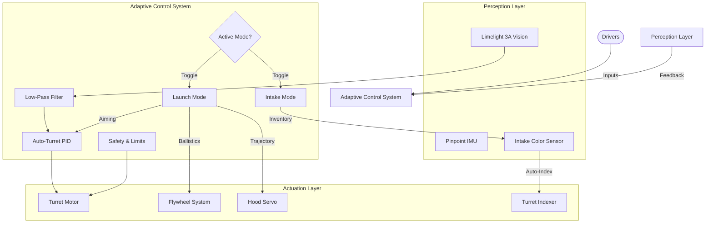

# 🤖 DECODE 14464: Software Engineering Portfolio (FTC 2026)

## 🚀 The DECODE Advantage
Our software philosophy centers on **"invisible complexity"**—hiding sophisticated control algorithms behind simple, intuitive interfaces for our drivers. By offloading precision tasks to the robot's onboard intelligence, we allow our drivers to focus on strategy rather than mechanics.

---

## 👁️ Vision-First Architecture: The Auto-Turret System
The centerpiece of our control system is the **Limelight-driven Auto-Turret**, transforming our robot into a "point-and-shoot" machine regardless of field orientation.

### 🎯 Intelligent Aiming Pipeline
Instead of manual alignment, we implemented a closed-loop tracking system that locks onto AprilTags (ID 20/24) instantly.
*   **PID+F Control Loop:** We use a tuned PID controller with **Feedforward** compensation to overcome static friction, ensuring aiming is smooth even at low speeds.
*   **Low-Pass Filtering:** Raw vision data is noisy. We implemented a **73% weighted low-pass filter** to smoothing camera inputs, eliminating "micro-jitters" and ensuring the shooter remains rock-steady.
*   **Camera Angle Compensation:** Our code mathematically compensates for the physical mounting angle of the camera vs. the shooter, ensuring the ball goes where the camera *aims*, not just where it *looks*.

### 🧠 Hybrid Control Logic
We solved the classic "automation vs. control" conflict with a priority-based override system:
1.  **Auto-Track (Default):** The turret aims itself.
2.  **Manual Override:** The operator can instantly seize control using **three** different input methods (D-Pad for precision, Sticks for speed), seamlessly disengaging the PID loop.
3.  **Safety Limits:** Soft software limits prevent the turret from damaging cables, enforced even during autonomous operations.

---

## 🎮 Adaptive Driver Control System
We engineered our TeleOp to be hardware-agnostic and incredibly ergonomic.

### 🔌 Universal Gamepad Support
Our code features **Auto-Detection** for controller types. Whether a driver hands us a PlayStation DualSense or an Xbox controller, our software remaps inputs instantly—Cross becomes A, Triangle becomes Y. No code changes, no delays.

### 🔄 Dynamic "Mode" Architecture
Instead of 20 different buttons, we use **Context-Aware Modes**:
*   **INTAKE MODE:** The turret snaps to intake positions, the color sensor wakes up, and the flywheel powers down. Turret indexing allows for rapid 3-slot loading.
*   **LAUNCH MODE:** The turret optimizes for shooting, the flywheel spins up to target velocity, and the hood adjusts to the preset firing angle.

### 🤝 Dual-Pilot Collaboration
We implemented **Shared Responsibility Controls**:
*   Example: The **Hood Angle** can be adjusted by the Driver (Gamepad 1 D-Pad Up/Down) OR the Operator (Gamepad 2 D-Pad Left/Right).
*   This redundancy ensures that if one driver is busy maneuvering, the other can fine-tune the shot without communication lag.

---

## ⚡ Automation Pipeline

### 🌈 Smart Intake System
We don't just spin motors; we sense the game.
*   **Color-Based Indexing:** An integrated color sensor inside the intake tunnel detects when a sample is secured.
*   **Auto-Advance:** Upon detecting a valid game element (Red/Blue/Yellow), the turret **automatically rotates** to the next empty slot. This allows the driver to simply drive into elements without managing storage manually.

### 💨 Optimized Ballistics
Our scoring isn't one-size-fits-all. We tuned specific physics profiles:
*   **Close Range Strategy:** 1100 RPM Flywheel / 0.50 Hood Angle.
*   **Far Range Strategy:** 1450 RPM Flywheel / 0.65 Hood Angle.
*   **Benefit:** Keeps the shot trajectory flat and fast for close shots, while providing the necessary arc for cross-field scoring.

---

## 🤖 Adaptive Autonomous Suite
We developed **four distinct autonomous programs** covering every possible standardized start position.

### 📍 Location-Aware Strategies
*   **Auto_Blue_Close / Auto_Red_Close:**
    *   *Strategy:* Speed.
    *   *Logic:* Optimization for short travel times. We cycle samples from the spike marks to the basket using lower velocity shots to minimize bounce-out.
*   **Auto_Blue_Far / Auto_Red_Far:**
    *   *Strategy:* Structure.
    *   *Logic:* Focuses on harvesting specimens from the observation zone and scoring on the high chamber using higher velocity profiles.

### 🛡️ Robust Fail-Safes
*   **Timeout Logic:** Every automated action (aiming, intaking) has a strict timeout. If the camera doesn't see a tag in 3.0 seconds, the robot proceeds to the next step rather than freezing.
*   **Alliance Mirroring:** Our codebase uses modular coordinate systems, allowing us to mirror complex paths perfectly between Red and Blue alliances.

---

## 💻 Code Quality & Architecture
*   **Modular Design:** Subsystems (Motors, Servos, Sensors, Vision) are encapsulated in separate classes (`DecodeUtils`, `RobotMotors`, `LimelightManager`), making the main OpMode clean and readable.
*   **Production-Grade Tuning:** We utilized a custom `FlywheelTuner` teleop to chart the exact RPM response curves, ensuring our PIDF coefficients are mathematically derived, not just guessed.

**DECODE 14464** isn't just driving a robot; we are managing a complex real-time system designed to win.

---

## 🖼️ System Architecture Visualization

