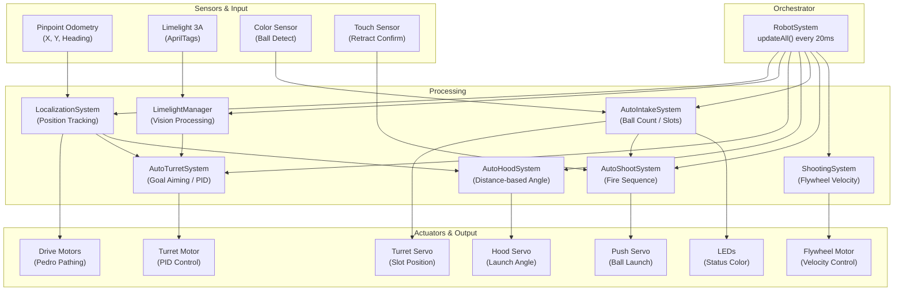
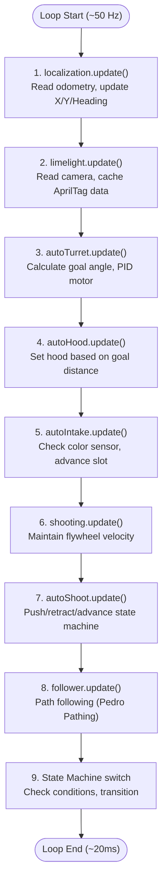
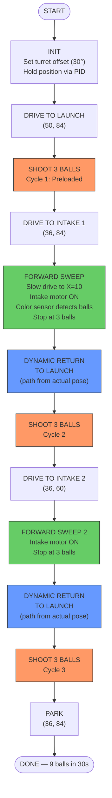
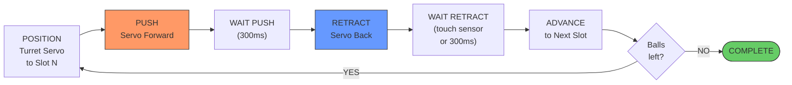
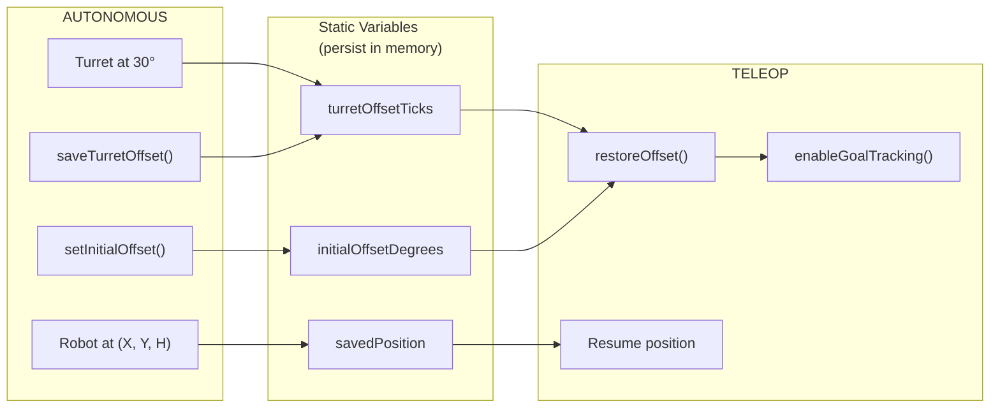

# DECODE 14464 — Autonomous System Overview

## Team & Challenge

DECODE Team 14464 competes in the FIRST Tech Challenge (FTC), where robots must perform tasks both autonomously (30 seconds, no driver input) and under driver control (TeleOp). Our 2026 season robot features a ball-shooting mechanism with a rotating turret, an automated intake system, and a vision-guided aiming system — all coordinated by a modular software architecture written in Java.

## The Problem

During autonomous, the robot must:
1. Start from a known position on the field
2. Shoot three preloaded balls into a goal
3. Drive to a ball collection zone, pick up three more balls
4. Return to the shooting position and shoot again
5. Repeat the intake-and-shoot cycle (for "Near" autos)
6. Park in a designated zone — all within 30 seconds

The challenge is coordinating precise movement, ball detection, turret aiming, and a multi-ball shooting mechanism under strict time constraints, with no human input.

## Our Solution: A Modular, State-Machine Architecture

### System Design

We decomposed the robot into **nine independent subsystems**, each with a single responsibility:

| System | Role |
|--------|------|
| **LocalizationSystem** | Tracks the robot's position and heading on the field using GoBILDA Pinpoint odometry |
| **AutoTurretSystem** | Aims the turret toward the goal using PID control, with multiple tracking modes |
| **AutoHoodSystem** | Adjusts the hood angle based on distance to the goal |
| **AutoIntakeSystem** | Detects balls via a color sensor, advances the turret servo to load up to 3 balls |
| **AutoShootSystem** | Fires balls one-by-one through a push-retract-advance state machine |
| **ShootingSystem** | Controls flywheel velocity for consistent launch speed |
| **LimelightManager** | Processes AprilTag detections from a Limelight 3A camera for position correction |
| **LEDSystem** | Visual feedback — green for intake mode, red for launch mode |
| **RobotSystem** | Central orchestrator that initializes and updates all subsystems in the correct order |

Every loop cycle (~50 Hz), `RobotSystem.updateAll()` calls each subsystem's `update()` method in a carefully ordered sequence: localization first (so all other systems have a fresh position), then vision, turret, hood, intake, and shooting.

### System Architecture Diagram

### Update Order (Every Loop Cycle)

### Autonomous Programs

We developed **four autonomous programs** — one for each starting position on the field:

- **Blue Near** / **Red Near**: 3 shoot cycles + 2 intake cycles (9 balls total)
- **Blue Far** / **Red Far**: 2 shoot cycles + 1 intake cycle (6 balls total)

Red programs are coordinate-mirrored from Blue (X_red = 144 − X_blue, heading flipped 180°).

Each autonomous uses an **enum-based state machine** with 15–20 states. A `transitionTo()` method handles state changes with timer resets, and every state has a timeout to prevent the robot from getting stuck.

### Autonomous Flow — Blue Near (3-Cycle, 9 Balls)

### AutoShoot State Machine (Per Ball)

### Auto-to-TeleOp Handoff

### Key Technical Features

**Pedro Pathing Integration** — We use the Pedro Pathing library for smooth path following with Bezier curves. Paths are defined as `BezierLine` segments with heading interpolation, and the `Follower` class handles motion profiling and PID-based trajectory tracking.

**Dynamic Path Generation** — After an intake sweep (which may end early if 3 balls are detected), the robot builds its return path dynamically from its actual current position rather than a hardcoded endpoint. This eliminates drift accumulation.

**Configurable Shooting Timings** — The `AutoShootSystem` supports `setFastTiming()` for Near autos (where every millisecond matters in a 3-cycle, 30-second window) and `setDefaultTiming()` for Far autos with more margin.

**Turret Pre-Aiming** — Before autonomous starts, the driver manually aims the turret to a known angle. The system records this as an offset (`setInitialOffset()`), then holds the position via PID throughout autonomous. This offset persists into TeleOp via static variables in `RobotMotors`, so the turret seamlessly transitions to goal-tracking mode.

**Phase Selection & Manual Advance** — During the init phase, drivers can select which phase to stop after (for testing individual segments) and enable manual-advance mode to step through states one at a time. This dramatically accelerated our field testing.

### Testing & Development Tools

- `TurretTest` (1,047 lines) — comprehensive turret calibration and testing OpMode
- `LocalizationTest` — validates odometry accuracy with known positions
- `TurretCalibration` — encoder-to-degree mapping verification
- `CompleteSystemTest` — end-to-end system integration test

## Results

Our autonomous system reliably scores **6–9 balls** per match in the 30-second autonomous period. The modular architecture allowed us to develop and test each subsystem independently, then integrate them with confidence. The state machine pattern made debugging straightforward — we could pinpoint exactly which state caused an issue and test it in isolation using the phase selection feature.

The same codebase seamlessly transitions from autonomous to driver-controlled operation, with turret offsets, position data, and system states preserved across the boundary.

---

*DECODE Team 14464 — FIRST Tech Challenge 2026*
